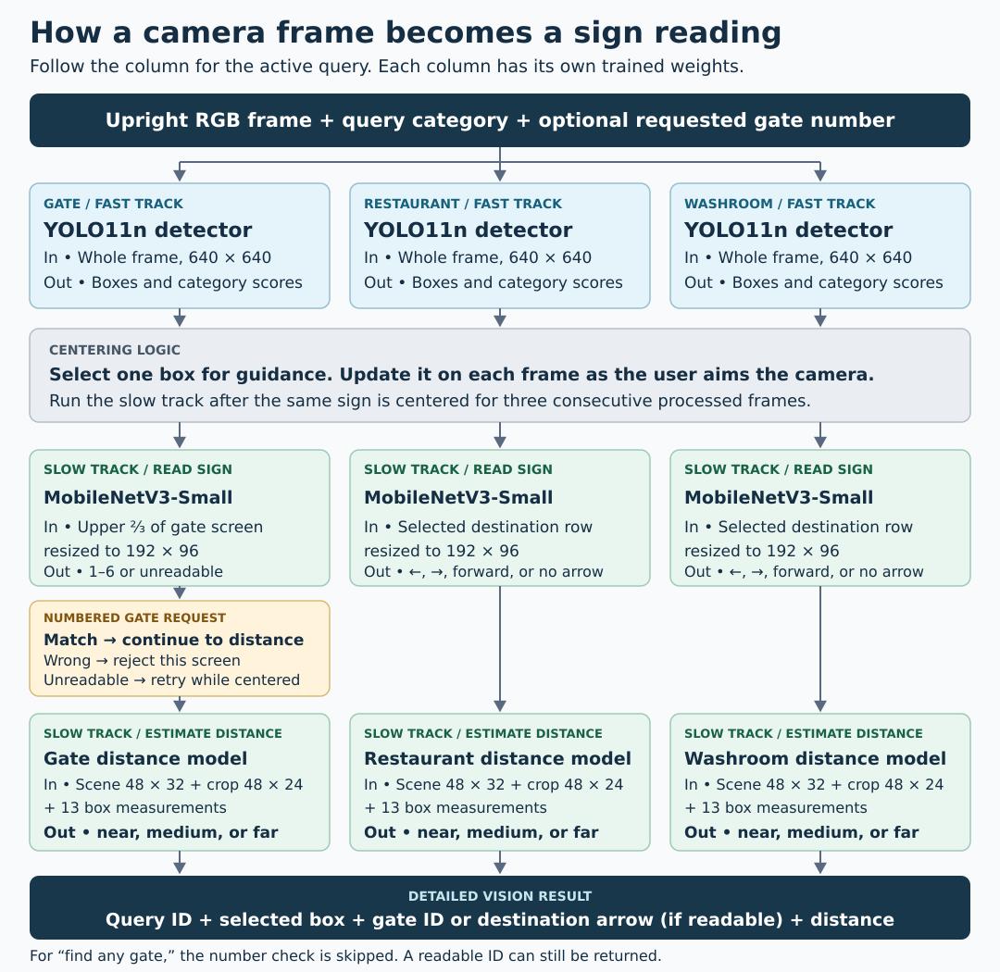
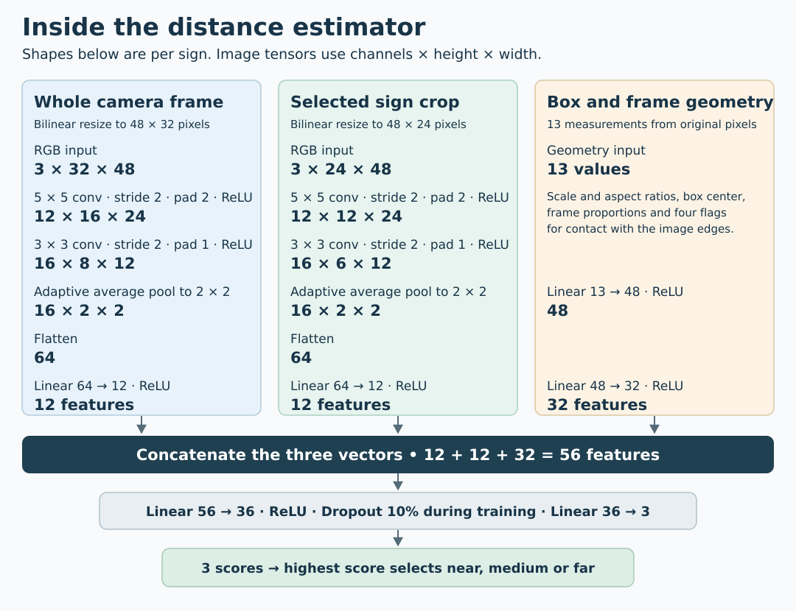
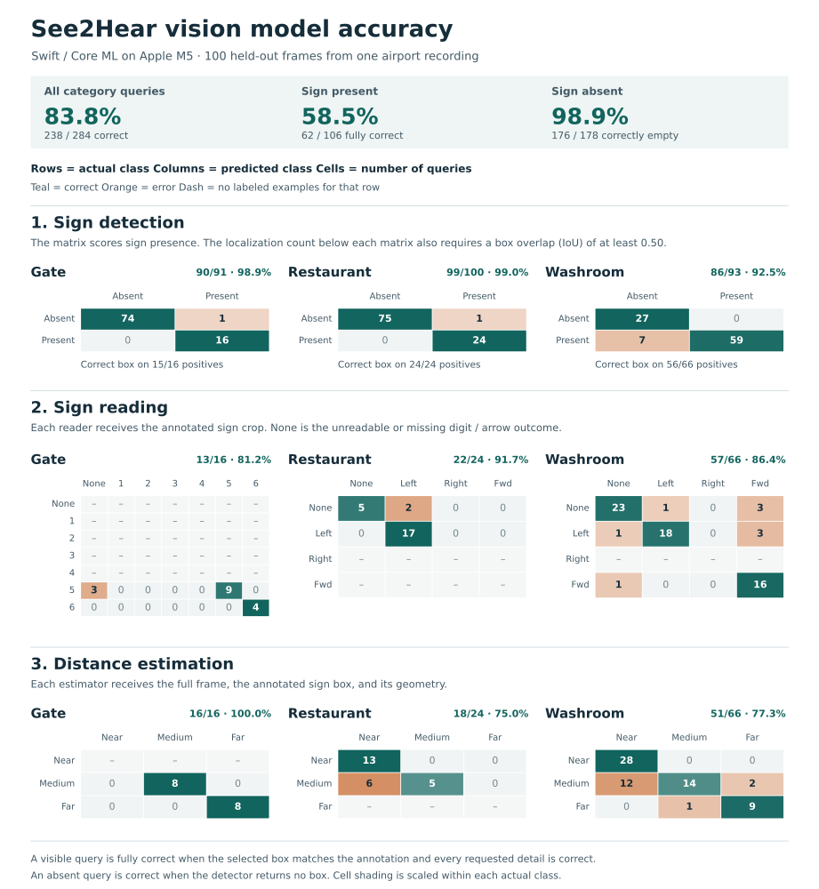

# Airport sign recognition

See2Hear takes an upright, unmirrored RGB frame and a single sign query. It returns the query ID, a box in original-frame pixels, and available sign metadata. The model targets the gate area in the supplied airport recordings. The Python pipeline is the integration reference for the iOS 17 app on iPhone 13 and later.

## Run the shipped models

From the repository root, use Python 3.10. The `test_data/vision/` directory contains the held-out MOV, 100 clean PNGs, and `labels.json`. Each frame entry names its PNG, maps evaluated sign categories to their ground truth, and records readable and ambiguous gate screens. An omitted category was excluded during annotation. The commands below run from a fresh checkout.

```bash
python3 -m venv .venv
.venv/bin/python -m pip install -r vision_experiments/requirements.txt
.venv/bin/python vision_experiments/test_pipeline.py
.venv/bin/python vision_experiments/evaluate.py --replay --output /tmp/see2hear-evaluation.json
```

The checked-in results are in `evaluation.json`. The evaluator runs the ONNX artifacts on CPU. It reads clean images, ground truth, the reviewed gate instances, and the held-out MOV for replay. It prints the metrics and model checksums. Omit `--replay` to run the annotated-frame benchmark alone. The following command requests a detailed reading of one upright frame.

```bash
.venv/bin/python vision_experiments/vision.py test_data/vision/frames/frame_000591.png gate --gate 5 --details
```

`--gate` restricts a search to a particular gate. `--details` explicitly runs the slow reader on the chosen box. On the supplied example the predicted gate is 5, the box is (372, 658, 78, 95) in a 1080 × 1920 frame, and the estimated distance is far. Live consumers call `VisionSession.analyze(image, query, timestamp_seconds)` in capture order and reuse the query UUID until the request changes.

## Runtime architecture

The fast track answers **“Where should the user point the camera?”** The slow track answers **“What does the sign in that spot say, and how far away does it appear?”** The fast track runs on every processed frame. A small piece of ordinary code, `VisionSession`, watches the boxes across frames and decides when to run the slow track.



### Walkthrough: “Find Gate 5”

1. **Find a gate screen.** The query selects the gate detector. It looks at the whole frame and draws a rectangle around each likely gate screen. If it finds two screens, it picks one using detection confidence, apparent size, and closeness to the image center. At this point the result contains the query ID and one box. The gate number, arrow, and distance fields are all empty.
2. **Guide the camera toward that box.** Suppose the box is above and left of the image center. The app can use those two positions to guide the user to point up and left. As the camera moves, the detector updates the box. If the screen disappears, the session returns an empty box and starts searching again. Speech and haptic feedback are handled outside Vision.
3. **Wait for a steady view.** The session checks that the box still overlaps the previous one and that its center sits inside the middle 24% of the image on both axes. After three consecutive centered observations of the same screen, it triggers the slow reader. This check uses the box coordinates and timestamps.
4. **Read the selected screen.** The reader crops the upper two-thirds of that box from the original-resolution frame, where the airport displays the gate number. It predicts a digit from 1 to 6 or marks it unreadable. For a Gate 5 request there are three outcomes.

| What the slow reader sees | What Vision returns and does next |
|---|---|
| **5**, with sufficient confidence | Returns the confirmed box, `observedGateID = "5"`, and the estimated distance. The app can now announce the match. |
| **Another readable number**, such as 6 | Returns an empty result and remembers that screen while it can track it. On the next frame, another visible gate screen can become the target for centering. |
| **An unreadable number** | Returns an empty result for this reading. If the screen stays centered, Vision retries after half a second. |

For example, the [Gate 5 test frame](../test_data/vision/frames/frame_000591.png) is 1080 × 1920 pixels. The fast track places the box center at about (411, 706), above and left of the image center at (540, 960). Both “find Gate 5” and “find Gate 3” initially produce that same guidance box. If you use the single-frame `--details` command above to read it immediately, Gate 5 returns a confirmed match at `far`, and Gate 3 returns an empty result. During live use, step 3 controls when that read happens.

### What changes for other queries?

| User request | Fast track finds | Slow track reads from the selected box |
|---|---|---|
| Find a gate | A gate screen | Its number when readable, plus distance. A generic gate search can return the screen and its distance even when the number is unreadable. |
| Find a washroom | A washroom destination row or pictogram panel | The arrow on that row, if readable, plus distance. |
| Find a restaurant | A restaurant destination row | The arrow on that row, if readable, plus distance. |

The row matters on a board with stacked destinations. If “Washrooms” points forward and “Restaurant” points left, a restaurant query selects the restaurant row and reads its arrow. A row with no readable arrow can still return a box and a distance.

### Neural network architecture by track

Each sign category has its own trained weights for three networks. The fast track runs one detector. After centering, the slow track runs a sign reader and a distance estimator for that category. The centering decision itself is ordinary box tracking code.

| Query | Fast detector | Slow sign reader | Slow distance estimator |
|---|---|---|---|
| Gate | Gate-screen YOLO11n | MobileNetV3-Small, 7 outputs (unreadable or a digit from 1 to 6) | Gate distance network, 3 outputs |
| Restaurant | Restaurant-row YOLO11n | MobileNetV3-Small, 4 outputs (no readable arrow, left, right, forward) | Restaurant distance network, 3 outputs |
| Washroom | Washroom-sign YOLO11n | MobileNetV3-Small, same 4 arrow outputs | Washroom distance network, 3 outputs |

**Fast track — YOLO11n object detector.** The input is the whole RGB frame, resized and padded to 640 × 640. The convolutional backbone extracts visual features. The next layers combine coarse features covering a large part of the scene with finer features that preserve small signs. The detection head reads three grids (80 × 80, 40 × 40, and 20 × 20). At each of the 8,400 grid locations it predicts a box center, width, height, and one score for the requested sign category. Postprocessing removes overlapping duplicates, ranks the candidates, and maps the selected box back onto the original frame. For a gate query the score means “this looks like a gate screen.” [Detector export](detection/export.py) · [Box selection](detection/inference.py)

**Slow track — sign reader.** A MobileNetV3-Small convolutional backbone receives a 192 × 96 RGB crop taken from the original frame. The gate model uses the top two-thirds of the display, which contains its number. Each arrow model uses the selected destination row. After the backbone, average pooling reduces the feature map to three horizontal positions with 576 features each. Flattening gives 1,728 values. A final linear layer converts them to seven gate scores or four arrow scores. The runtime uses these scores to decide whether the reading is confident enough to publish. [Reader networks](readers/networks.py) · [Crop preparation](readers/preprocess.py)

**Slow track — distance estimator.** This custom network has three parallel branches. Two small convolutional encoders process the 48 × 32 full scene and the 48 × 24 sign crop independently. Each uses two stride-2 convolutions (5 × 5 then 3 × 3), pooling, and a linear layer to produce 12 features. A third branch takes 13 box measurements, including scale, position, and contact with frame edges, through two linear layers (13 → 48 → 32). The model joins the three outputs into 56 features (12 + 12 + 32). A final classifier (56 → 36 → 3) scores near, medium, and far. This gives the estimator access to both the sign and its surroundings. For a numbered gate request, distance runs after the reader confirms the requested number. [Distance network](readers/networks.py) · [Inputs](readers/preprocess.py)



While the target stays centered, its box updates on each processed frame and its details refresh at most twice per second. The caller can use `session.phase` to distinguish a provisional `guiding` box from a `verified` result ready for feedback.

**Implementation thresholds.** The detector keeps scores of at least 0.25 and removes duplicate boxes whose overlap exceeds 0.45. Overlap is the shared area divided by the total area covered by either box. The session requires at least 0.40 overlap between consecutive boxes and at most 0.5 seconds between observations to continue the same track. The gate reader requires confidence of at least 0.70 to report a number. The arrow reader requires at least 0.55 to report a direction.

## Data and training

All splits are by source recording. The 11 active training videos provide 1,039 primary positive records and 1,967 negatives. The sole test recording is `IMG_8458.MOV`. Model training uses clean frames from `data/unannotated/` and reads targets from the mappings under `data/annotated/`. The rendered red boxes are for annotation review. Training uses the final fixed epoch checkpoint. The clean-image manifest contains 100 distinct test-frame hashes and 1,058 distinct training-frame hashes, with zero shared hashes.

| Sign | Train positive / negative | Test positive / negative |
|---|---:|---:|
| Washroom | 417 / 580 | 66 / 27 |
| Restaurant | 278 / 742 | 24 / 76 |
| Gate | 344 / 645 | 16 / 75 |

The generic target is the single clearest sign. For numbered queries, the supplemental audit inspected all 906 original gate candidates across the 12 clips. It identified 570 readable instances and marked 336 unreadable regions. The test video contains 26 readable instances across 16 positive frames, including ten frames with two readable gates. The gate detector uses 542 readable boxes on active training records. The gate reader also uses two supplemental readable training instances outside those records. Previous annotations and clean frames remain under the Git-ignored `data/` directory.

**Detectors.** Each detector begins with COCO-pretrained YOLO11n weights. Fine-tuning uses AdamW, 28 epochs, seed 42, two epochs of frozen backbone, cosine learning-rate decay from 0.001 toward 0.00008, and 640-pixel inputs. Training augments scale, translation, color and small rotations. Background classification loss ignores anchors centered inside discarded sign regions. The YOLO model artifacts carry AGPL-3.0 licensing information. See `detection/models/LICENSE` and the pinned upstream checkpoint URL and checksum in `detection/train.py`.

**Readers.** Each crop classifier starts from ImageNet-pretrained MobileNetV3-Small weights. Training freezes the first three feature blocks and fine-tunes for 22 epochs. The three distance networks train from scratch for 48 epochs. The readers use AdamW, class-weighted sampling, exposure augmentation and box jitter. Arrow flips exchange left and right targets. The gate reader sees positively identified screens, unreadable screen crops, sampled backgrounds and 450 synthetically rendered headers. The mapping from dataset labels to Swift uses `front → forward` and `mid → medium`.

Train from `vision_experiments/` using the detector training dependencies in `detection/train-requirements.txt` and a separate environment using `readers/train-requirements.txt` for readers. Training requires access to the initial published weights. The detector trainer stores intermediate datasets and checkpoints in the ignored data tree.

```bash
python detection/train.py --category gate
python detection/train.py --category restaurant
python detection/train.py --category washroom
python -m readers.train --device cuda
python -m readers.export_coreml
```

## Evaluation protocol

Generic detection scores the selected box at IoU ≥ 0.50 with the primary annotation. A wrong box on a positive frame incurs both a false positive and a false negative. Center error is Euclidean center displacement divided by image diagonal, averaged over correct detections. For the slow-path benchmark the evaluator explicitly requests details on predicted boxes, regardless of centering. It separately evaluates readers on ground-truth crops to distinguish reading errors from localization errors.

For numbered queries the benchmark issues all six requests per sampled frame. Each request receives the same category-only candidate for centering. At the simulated slow-track trigger, the reader may confirm that candidate or return a miss. A confirmation must overlap a readable screen of the requested ID. Publishing another readable screen as a match counts as a false confirmation. Provisional boxes are scored separately. Unreadable screen regions have uncertain IDs and are handled separately. The report includes an all-readable-box gate-ID score to distinguish candidate selection from digit reading.

Replay runs the live centering state machine at approximately 5 Hz, sharing image inference across query streams. It checks all 100 annotated timestamp pixels against the cached source PNGs. Replay counts describe emitted boxes and detail refreshes. Correctness metrics use the reviewed frame annotations.

## Held-out results

These results use the shipped ONNX models on the 100 sampled frames of `IMG_8458.MOV`. A frame can carry multiple category queries. The 284 active frame/category records include 106 positives and 178 negatives. Categories omitted by the visibility review stay outside the generic evaluation.

| Query | Correct boxes / positives | Precision | Recall | False alarms / negative frames | All fields and box correct / positives |
|---|---:|---:|---:|---:|---:|
| Gate | 15 / 16 | 88.2% | 93.8% | 1 / 75 | 11 / 16 |
| Restaurant | 24 / 24 | 96.0% | 100% | 1 / 76 | 13 / 24 |
| Washroom | 56 / 66 | 94.9% | 84.8% | 0 / 27 | 38 / 66 |

Across categories, 95 of 106 positive signs were correctly localized. Precision was 95/101 (94.1%) and recall was 95/106 (89.6%). The mean center error for correct detections was 0.20% of image diagonal for gates, 0.34% for restaurants, and 0.46% for washrooms. The complete box and every requested metadata field were correct on 62/106 positive queries.

| Query | Number or arrow correct on correctly localized boxes | Distance correct on correctly localized boxes | Number or arrow correct on ground-truth boxes | Distance correct on ground-truth boxes |
|---|---:|---:|---:|---:|
| Gate | 11 / 15 | 15 / 15 | 13 / 16 | 16 / 16 |
| Restaurant | 23 / 24 | 14 / 24 | 22 / 24 | 18 / 24 |
| Washroom | 51 / 56 | 42 / 56 | 57 / 66 | 51 / 66 |

The gate reader abstained on four correctly localized primary screens. It returned the correct ID on the other eleven. Arrow accuracy includes correct abstentions when the destination row has no readable arrow. Restaurant distance was the weakest field. Ten of the eleven correctly localized medium-distance rows were classified near. For washrooms, eleven of 25 correctly localized medium-distance rows were also classified near. The training recordings contain just twelve medium-distance restaurant positives and zero near-gate positives. Distance supervision comes from visual judgments of scene depth. This single-recording test measures performance in the specific airport area and covers gate IDs 5 and 6.

### Numbered gate confirmation

The forced-slow benchmark first selects **one generic screen** on each frame. Of 26 positive numbered requests, the selected screen was the requested one in 16 cases. The reader confirmed 12 of these and abstained on four. The other ten requests had a readable requested gate elsewhere in the frame. They need another centering attempt. Gate 5 was confirmed in 9/14 positive requests and Gate 6 in 3/12. Across 521 scored requests there were **12 correct confirmations and zero false confirmations**. The remaining 79 of the 600 issued requests involved an unresolved screen ID.

On all 26 manually boxed readable screens, the digit reader returned 19 correct IDs and seven abstentions. When explicitly given the 21 manually boxed unreadable regions, it abstained on 17 and assigned a number to four. The zero false confirmations in the scored pipeline should be interpreted with that coverage limit. The confidence threshold was fixed before testing.

### Live-policy replay

On the prerecorded 2,577-frame test MOV, the 5 Hz replay processed 430 frames per query. It issued 81 provisional gate guides for each numbered query. The camera never held the selected gate inside the center tolerance for three consecutive replay frames, so **the replay produced zero gate-number reads or confirmations**. It produced one slow washroom read and zero restaurant reads. The forced-slow results above measure what the readers can extract once invoked. This walkthrough does not measure how often a person following live guidance would successfully center the target.

As a separate runtime check, three observations 0.1 seconds apart of the centered, real training image `bulk_v1_IMG_8459_f001395_gate_01.png` produced two provisional boxes followed by a verified Gate 6. Requesting Gate 1 produced two provisional boxes followed by a rejected result. The unit tests also cover switching to a second visible screen after rejection.

On a Linux i7-12700K CPU, the median detector call took 37.8–39.4 ms and the 95th percentile took 44.7–52.3 ms across the three categories. The median additional metadata call on a selected box took 6.1–7.8 ms. These measurements include preprocessing and postprocessing, exclude PNG decoding, and omit the first call per stage. Pass `--timings /tmp/see2hear-timings.json` to measure the evaluation host.

## Swift/Core ML

`CoreMLSignRecognizer` implements `VisionModelInvoking` and the existing `SignRecognizing` contract. Xcode compiles the nine FP16 model packages directly from this directory into the iOS app bundle. Keep one recognizer across calls to reuse loaded models. It accepts upright, unmirrored RGB frames and returns boxes in top-left source-image pixels.

```swift
let models = CoreMLSignRecognizer()
let candidates = try await models.detect(frame: frame, category: .gate)
```

Given a box selected by the caller, either reader can run independently. A gate reader returns `.gate(number)` for a digit from 1 to 6, or `nil`. Restaurant and washroom readers return `.arrow(direction)` or `nil`. The distance estimator accepts the whole detected or annotated box, including for gates.

```swift
let sign = try await models.readSign(frame: frame, category: .gate, box: box)
let distance = try await models.estimateDistance(frame: frame, category: .gate, box: box)
```

`locate` returns the highest-ranked guidance box. `readDetails` evaluates the supplied candidate and enforces a requested gate ID. Orchestration controls frame capture, candidate selection, centering, and when to invoke the readers.

### Reproduce the Apple benchmark

On a Mac with Xcode selected, run `./scripts/benchmark-vision.sh` from the repository root. With Xcode installed at its standard path, `DEVELOPER_DIR=/Applications/Xcode.app/Contents/Developer ./scripts/benchmark-vision.sh` also works. The script builds an optimized executable from the app's Swift sources, compiles the shipped Core ML packages, and evaluates the 100 PNGs listed in `test_data/vision/labels.json`.

On a paired iPhone, choose the phone as the Xcode destination and run `VisionModelTests.heldOutBenchmark()`. To measure optimized code from the command line, use the following command with your paired device ID and a development team configured for signing. The fixtures live in the test bundle. The same benchmark prints per-model counts and timings to the test console.

```sh
xcodebuild test -project See2Hear.xcodeproj -scheme See2Hear \
  -configuration Release -destination 'platform=iOS,id=<device-id>' \
  -only-testing:See2HearTests/VisionModelTests \
  ENABLE_TESTABILITY=YES
```

### Apple accuracy and latency



On an Apple M5 MacBook Pro, the Swift/Core ML and Python/ONNX implementations produced the same counts below. Localization requires IoU ≥ 0.50. The independent reader columns score the annotated box on every positive. The final column requires the selected detector box and every requested field to be correct.

| Category | Positive queries | Correct boxes | False positive boxes | Correct digit or arrow on annotated box | Correct distance on annotated box | Correct box and all fields |
|---|---:|---:|---:|---:|---:|---:|
| Gate | 16 | 15 | 2 | 13 | 16 | 11 |
| Restaurant | 24 | 24 | 1 | 22 | 18 | 13 |
| Washroom | 66 | 56 | 3 | 57 | 51 | 38 |

The iOS 26.2 simulator reproduced the box, distance and complete-result counts. It read 56/66 washroom arrows on annotated crops. On frame 1822 the reader received byte-identical RGB inputs in Python, native macOS and the simulator. The left-arrow confidence was 0.5734 in ONNX, 0.5507 on the M5 and 0.5454 in the simulator. The shared 0.55 threshold makes the simulator abstain. This evaluation covers one airport recording.

Warm wall-clock latency on the M5 MacBook Pro (macOS 26.6.2, Xcode 26.2, optimized Swift, Core ML compute units `.all`) is shown in milliseconds. Each cell gives p50 / p95. Timing starts with a decoded, upright 1080 × 1920 frame and includes the Swift call, preprocessing, inference, and output decoding. Each model's first timed call is excluded to omit initial loading. The detector has 90/99/92 warm samples for gate/restaurant/washroom and each reader has 15/23/65. Physical iPhone latency and sustained thermal performance remain unmeasured.

| Category | Detector (ms) | Sign reader (ms) | Distance estimator (ms) |
|---|---:|---:|---:|
| Gate | 8.39 / 9.04 | 1.05 / 1.22 | 3.11 / 3.55 |
| Restaurant | 7.01 / 8.62 | 1.27 / 1.52 | 3.04 / 3.42 |
| Washroom | 6.86 / 7.66 | 1.19 / 1.73 | 2.91 / 3.28 |
